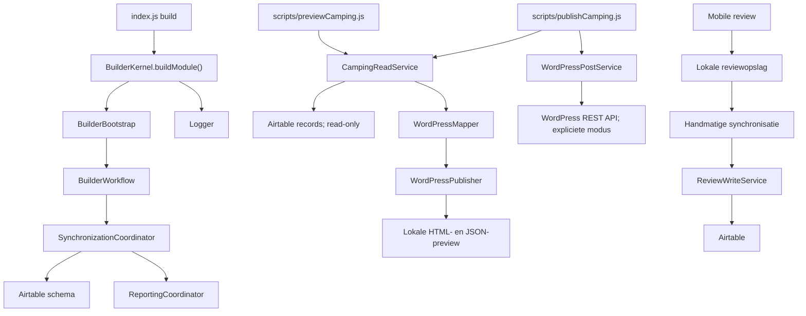

<!-- ========================================================================== -->
<!-- RZD Builder                                                                -->
<!-- ARCHITECTURE                                                               -->
<!-- ========================================================================== -->

# ARCHITECTURE

| Eigenschap | Waarde |
|------------|--------|
| Document | ARCHITECTURE.md |
| Project | RZD Builder |
| Versie | 2.0 |
| Status | Actief |
| Laatste wijziging | 06-11-2026 |
| Eigenaar | Pascalle Vroegop |

---

# Doel

Dit document beschrijft de architectuur van RZD Builder.

Het beschrijft de verantwoordelijkheden van de belangrijkste componenten en hun onderlinge samenhang.

De architectuur wordt beschreven op basis van de huidige uitvoeringspaden. Aanwezige componenten en toekomstige uitbreidingen worden niet automatisch beschouwd als onderdeel van de actuele workflow.

---

# Architectuurprincipes

RZD Builder is opgebouwd uit zelfstandige componenten.

Iedere component heeft een duidelijk afgebakende verantwoordelijkheid.

Belangrijke uitgangspunten:

- Single Responsibility Principle;
- modulaire opbouw;
- minimale afhankelijkheden;
- geen dubbele logica;
- hergebruik bestaande services;
- kleine, testbare functies;
- veilig uitvoeren van wijzigingen;
- duidelijke scheiding tussen read-, preview- en write-functionaliteit.

---

# Hoofdstuk 1 – Architectuuroverzicht

## Doel

RZD Builder ondersteunt het beheren, valideren, verwerken en synchroniseren van gegevens binnen het Reizen zonder Drempels-project.

De bestaande architectuur bevat meerdere uitvoeringspaden:

1. Schema- en configuratiesynchronisatie.
2. CampingAggregate ophalen en presenteren.
3. WordPress-conceptpublicatie.
4. Mobiele reviewopslag en synchronisatie.

Deze paden gebruiken waar nodig gedeelde services, maar vormen niet één doorlopende BuilderKernel-pipeline.

## Architectuuroverzicht



## Architectuurlagen

### Applicatielaag

Bevat de startpunten van de applicatie.

Voorbeelden:

- `index.js`
- `scripts/previewCamping.js`
- `scripts/publishCamping.js`
- mobiele reviewroutes

### Orchestratielaag

De BuilderKernel coördineert de schema-sync-workflow die via:

`node index.js build <module>`

wordt gestart.

De kernel is niet de ingang voor alle scripts en services van RZD Builder.

### Verwerkingslaag

Compiler en Pipeline zijn aanwezige componenten.

De huidige `index.js build`-workflow roept deze componenten niet aan als de eerder beschreven generieke Compiler → Pipeline-keten.

De schema-sync verloopt via `BuilderWorkflow` en `SynchronizationCoordinator`.

### Servicelaag

Services bevatten de functionele verwerking.

Voorbeelden:

- `BuilderBootstrap`
- `BuilderWorkflow`
- `SynchronizationCoordinator`
- `ReportingCoordinator`
- `CampingReadService`
- `ReviewWriteService`

### Adapterlaag

Adapters verzorgen de communicatie met externe systemen.

Voorbeelden:

- Airtable
- WordPress

De concrete communicatie verschilt per uitvoeringspad.

### Rapportagelaag

De schema-sync gebruikt `ReportingCoordinator` en logging.

De preview- en publicatiescripts hebben hun eigen uitvoer en resultaten.

---

# Hoofdstuk 2 – Ontwerpprincipes

## 2.1 Modulaire architectuur

Het systeem bestaat uit zelfstandige componenten met een duidelijk afgebakende verantwoordelijkheid.

## 2.2 Single Responsibility Principle

Iedere component heeft één primaire verantwoordelijkheid.

Voorbeelden:

- BuilderKernel coördineert de schema-sync.
- BuilderWorkflow bouwt de workflow op.
- SynchronizationCoordinator voert schema-synchronisatie uit.
- CampingReadService stelt CampingAggregate samen.
- ReviewWriteService verzorgt de upsert-logica voor beoordelingen.

## 2.3 Metadata boven hardcoded logica

Waar mogelijk wordt gedrag bepaald door configuratie en metadata.

## 2.4 Losse koppeling

Componenten communiceren via duidelijke interfaces.

De CampingReadService staat los van BuilderKernel, BuilderWorkflow en SynchronizationCoordinator.

## 2.5 Herbruikbaarheid

Bestaande services worden hergebruikt wanneer zij dezelfde verantwoordelijkheid hebben.

## 2.6 Testbaarheid

Afhankelijkheden worden waar mogelijk geïnjecteerd.

Lokale tests en mocktests moeten duidelijk onderscheiden blijven van echte externe integratietests.

## 2.7 Veiligheid

Productieacties worden niet uitgevoerd zonder expliciete controle.

Bij twijfel wordt niet geschreven.

---

# Hoofdstuk 3 – Systeemarchitectuur

## Inleiding

RZD Builder bevat een schema-sync-workflow en afzonderlijke services voor campingdata, WordPress en mobiele reviews.

De architectuur moet daarom per uitvoeringspad worden gelezen.

## 3.1 Schema-sync-workflow

```text
index.js build <module>
        │
        ▼
BuilderKernel.buildModule()
        │
        ▼
BuilderBootstrap
        │
        ▼
BuilderWorkflow
        │
        ▼
SynchronizationCoordinator
        │
        ├── Airtable schema
        ├── Synchronisatie
        └── ReportingCoordinator

BuilderKernel
        │
        └── Logger
```

### Workflow

1. De module laden en valideren.
2. De Airtable-veldlijst ophalen.
3. De BuilderContext opbouwen.
4. De module vergelijken.
5. Een synchronisatie- en rollbackplan maken.
6. De synchronisatie uitvoeren of als dry-run verwerken.
7. Rapportages en logging afronden.

De exacte uitvoeringsmodus bepaalt of wijzigingen daadwerkelijk worden uitgevoerd.

## 3.2 CampingAggregate-preview

```text
scripts/previewCamping.js
        │
        ▼
CampingReadService
        │
        ▼
Airtable read-only
        │
        ▼
CampingAggregate
        │
        ▼
WordPressMapper
        │
        ▼
WordPressPublisher
        │
        ▼
Lokale HTML- en JSON-bestanden
```

De previewflow haalt campinggegevens op en stelt een aggregate samen.

De preview schrijft lokale bestanden.

De previewflow is geen schema-sync en gebruikt de BuilderKernel niet als orchestrator.

## 3.3 WordPress-conceptpublicatie

```text
scripts/publishCamping.js
        │
        ▼
CampingReadService
        │
        ▼
CampingAggregate
        │
        ▼
WordPressPostService
        │
        ▼
WordPress REST API
```

De publicatieflow gebruikt de CampingAggregate als invoer.

De WordPress-laag ondersteunt het voorbereiden en aanmaken/hergebruiken van Pages als concept.

Een bestaande Page wordt niet automatisch bijgewerkt door alleen opnieuw publiceren.

De afzonderlijke updateflow vereist een expliciete gecontroleerde actie.

Er is geen bewijs dat de huidige flow een publieke productiepublicatie uitvoert.

## 3.4 Mobiele reviewflow

```text
Browser
   │
   ▼
Mobile review routes
   │
   ▼
Lokale reviewopslag
   │
   ▼
Pending reviews
   │
   ▼
Handmatige synchronisatie
   │
   ▼
ReviewWriteService
   │
   ▼
Airtable
```

De mobiele reviewflow ondersteunt lokale opslag en handmatige synchronisatie.

De write-grens gebruikt de bestaande review-write-service.

Een volledige gecombineerde live browser-naar-Airtable-test is niet aangetoond.

---

# Hoofdstuk 4 – RZD Datamodel

## Doel

Het RZD-datamodel beschrijft de gegevensstructuur die door de Builder en de campingservices wordt gebruikt.

De bestaande RZD 5.1 Airtable-structuur blijft leidend.

## Hoofdobjecten

### Accommodaties

De bestaande tabel `Accommodaties` bevat camping-/parkgegevens en accommodatiegegevens.

Camping/park is voor de huidige RZD-focus het primaire object.

### Voorzieningen

Voorzieningen zijn afzonderlijke records die aan een camping/park gekoppeld zijn.

Voorbeelden:

- sanitairgebouw;
- zwembad;
- supermarkt;
- restaurant;
- strand;
- EHBO;
- arts;
- wasserette.

Verschillende voorzieningen van hetzelfde type blijven afzonderlijke records.

### Beoordelingspunten

De bestaande tabel `Beoordelingspunten` blijft leidend voor de beoordelingspunten.

### Accommodatie beoordelingen

De bestaande tabel `Accommodatie beoordelingen` bevat beoordelingen.

De tabel ondersteunt zowel een accommodatie- als een voorzieningkoppeling.

Precies één van beide wordt per beoordeling gebruikt.

### Verbeterpunten

`Verbeterpunten` vormt een afzonderlijke rapportage-/actielaag.

De relatie omvat:

- Accommodatie;
- Module;
- Beoordelingspunt.

### Bronnen

`Bronnen` vormt een afzonderlijke relationele evidence-/provenance-laag.

Meerdere bronnen kunnen bij een accommodatie en/of beoordeling horen.

## Datamodelregels

- Geen nieuwe Airtable-base.
- Geen nieuwe Content Modules-tabel.
- Geen nieuwe Accommodatie Beoordelingen-tabel.
- Geen aparte Campings-tabel.
- Geen aparte Voorzieningen beoordelingen-tabel.
- Bestaande RZD-data wordt niet verwijderd.
- De bestaande tabellen blijven leidend.

---

# Hoofdstuk 5 – Projectstructuur

## Inleiding

De broncode is georganiseerd volgens een modulaire projectstructuur.

De exacte inhoud kan per release verschillen.

```text
RZD Builder
│
├── compiler/
├── core/
├── builders/
├── services/
├── adapters/
├── modules/
├── config/
├── tools/
├── reports/
├── generated/
├── docs/
├── tests/
├── scripts/
│
├── README.md
├── LICENSE
└── package.json
```

## compiler/

Bevat de Compiler-component.

De Compiler is aanwezig, maar wordt niet aangeroepen door de huidige `index.js build`-schema-sync-workflow.

## core/

Bevat de kerncomponenten.

Voorbeelden:

- BuilderKernel;
- gedeelde basisfunctionaliteit;
- centrale orkestratie.

## builders/

Bevat gespecialiseerde builders.

## services/

Bevat functionele verwerking.

Voorbeelden:

- `campingReadService.js`;
- `reviewWriteService.js`;
- metadata-, validatie- en vergelijkingsservices.

## adapters/

Bevat communicatie met externe systemen.

Voorbeelden:

- Airtable;
- WordPress.

## modules/

Bevat zelfstandige functionaliteit.

## config/

Bevat configuratiebestanden.

## tools/

Bevat ondersteunende ontwikkel- en onderhoudstools.

## reports/

Bevat rapportagefunctionaliteit.

## generated/

Bevat automatisch gegenereerde bestanden.

## docs/

Bevat projectdocumentatie.

## tests/

Bevat geautomatiseerde tests.

## scripts/

Bevat uitvoerings-, test-, preview- en publicatiescripts.

---

# Hoofdstuk 6 – BuilderKernel

## Doel

De BuilderKernel coördineert de bestaande schema-sync-workflow.

De kernel bevat zo min mogelijk bedrijfslogica.

## Verantwoordelijkheden

- aanroepen van `BuilderBootstrap.create()` om een module en context voor te bereiden;
- aanroepen van `BuilderWorkflow.run()` om verschillen en synchronisatieplannen op te bouwen;
- aanroepen van `SynchronizationCoordinator.run()` voor schema-synchronisatie;
- aanroepen van `ReportingCoordinator.run()` voor rapportage;
- afhandelen en loggen van fouten in het build-pad.

## Positie binnen de architectuur

```text
index.js build <module>
        │
        ▼
BuilderKernel.buildModule()
        │
        ├── BuilderBootstrap
        ├── BuilderWorkflow
        ├── SynchronizationCoordinator
        ├── ReportingCoordinator
        └── logger
```

## Workflow

Tijdens een schema-sync-uitvoering:

1. De module laden en valideren.
2. De Airtable-veldlijst ophalen.
3. De BuilderContext opbouwen.
4. De module vergelijken.
5. Een synchronisatie- en rollbackplan maken.
6. Synchronisatie uitvoeren of dry-run verwerken.
7. Rapportage en logging afronden.

## Afhankelijkheden

De BuilderKernel is direct afhankelijk van:

- `BuilderBootstrap`;
- `BuilderWorkflow`;
- `SynchronizationCoordinator`;
- `ReportingCoordinator`;
- logging en rollbackplanning.

De kernel roept geen WordPress-integratie aan.

Airtable-interactie voor het build-pad wordt door de bootstrap- en synchronisatiecomponenten uitgevoerd.

De CampingReadService staat los van deze workflow.

## Samenvatting

De BuilderKernel coördineert de bestaande `index.js build`-schema-sync-workflow.

De CampingAggregate-preview en WordPress-conceptflow starten via afzonderlijke scripts en blijven buiten deze kernelworkflow.

---

# Hoofdstuk 7 – Compiler

## Doel

De Compiler is een aanwezige component voor het verwerken van invoergegevens en het omzetten daarvan naar een interne representatie.

De huidige `index.js build`-workflow roept deze Compiler niet aan.

Dit hoofdstuk beschrijft daarom de component en niet de actuele uitvoeringsvolgorde van de schema-sync.

## Verantwoordelijkheden

- invoer verwerken;
- structuur controleren;
- basisvalidaties uitvoeren;
- gegevens normaliseren;
- interne objecten opbouwen;
- resultaten voorbereiden.

## Positie binnen de architectuur

```text
Compiler
   │
   ▼
Interne representatie
```

De bovenstaande relatie beschrijft de componentfunctie en is geen actuele schema-sync-callflow.

## Input

Mogelijke invoer:

- configuratie;
- metadata;
- JSON;
- CSV;
- API-responses.

## Output

Een interne gegevensstructuur die door een volgende verwerkingscomponent kan worden gebruikt.

## Foutafhandeling

Mogelijke fouten:

- ontbrekende verplichte velden;
- ongeldige waarden;
- onbekende configuraties;
- onvolledige metadata.

## Samenvatting

De Compiler is een aanwezige verwerkingscomponent.

De actuele schema-sync-workflow gebruikt `BuilderWorkflow` en `SynchronizationCoordinator` en roept de Compiler niet aan.

---

# Hoofdstuk 8 – Pipeline

## Doel

De Pipeline is een aanwezige component voor het uitvoeren van verwerkingsstappen.

De huidige `index.js build`-workflow roept deze Pipeline niet aan.

De schema-sync verloopt via `BuilderWorkflow` en `SynchronizationCoordinator`.

## Componentfunctie

Een Pipeline kan verwerkingsstappen organiseren zoals:

- initialisatie;
- validatie;
- normalisatie;
- verrijking;
- bedrijfslogica;
- synchronisatievoorbereiding;
- rapportage.

Deze beschrijving is geen bewijs dat deze fasen als één actuele schema-sync-pipeline worden uitgevoerd.

## Ontwerpprincipes

- onafhankelijke verwerkingsstappen;
- duidelijke input en output;
- minimale onderlinge afhankelijkheden;
- reproduceerbare verwerking;
- gecontroleerde foutafhandeling.

## Samenvatting

De Pipeline is een aanwezige component.

De huidige schema-sync-workflow loopt via `BuilderWorkflow` en `SynchronizationCoordinator`.

---

# Hoofdstuk 9 – Services

## Doel

Services bevatten de functionele verwerking van RZD Builder.

Services voeren controles uit, verwerken gegevens en bereiden resultaten voor.

De concrete serviceketen verschilt per uitvoeringspad.

## Builder-services

Voor de schema-sync zijn onder andere aanwezig:

- `BuilderBootstrap`;
- `BuilderWorkflow`;
- `SynchronizationCoordinator`;
- `ReportingCoordinator`.

## ReviewWriteService

Centrale upsert-service voor de tabel `Accommodatie beoordelingen`.

Ondersteunt:

- accommodatiebeoordelingen;
- voorzieningbeoordelingen.

Precies één van beide koppelingen is verplicht.

Duplicate-safety:

- 0 matches → CREATE;
- 1 match → UPDATE;
- meer dan 1 match → BLOCKED_MULTIPLE_MATCHES.

## CampingReadService

Read-only service die een `CampingAggregate` samenstelt uit:

- Accommodaties;
- Voorzieningen;
- Accommodatie beoordelingen;
- waar van toepassing Keuzeopties;
- Reizigerservaringen;
- Opmerkingen.

De readservice staat los van BuilderKernel, BuilderWorkflow en SynchronizationCoordinator.

## Ontwerpprincipes

Services:

- hebben één verantwoordelijkheid;
- zijn herbruikbaar;
- zijn testbaar;
- hebben duidelijke input en output;
- bevatten geen gebruikersinterface.

## Samenvatting

Services vormen de functionele laag van RZD Builder.

De CampingReadService en ReviewWriteService ondersteunen afzonderlijke camping- en reviewflows en vormen geen onderdeel van de schema-sync-kernelworkflow.

---

# Hoofdstuk 10 – Adapters

## Doel

Adapters verzorgen de technische communicatie met externe systemen.

Zij vertalen interne gegevens naar het formaat dat een extern systeem verwacht en verwerken ontvangen gegevens.

## Verantwoordelijkheden

- verzenden en ontvangen van gegevens;
- technische API-communicatie;
- vertalen van gegevensformaten;
- verwerken van technische fouten;
- beheren van verbindingen.

Adapters bevatten geen bedrijfslogica.

## Externe systemen

- Airtable;
- WordPress.

## Airtable

Airtable wordt gebruikt voor de bestaande RZD 5.1-gegevensstructuur.

De schema-sync en campingreadflow gebruiken Airtable op verschillende manieren.

## WordPress

WordPress wordt gebruikt voor de accommodatiepresentatie en conceptpublicatie.

De WordPress-integratie wordt niet door de BuilderKernel aangeroepen.

## Samenvatting

Adapters vormen de technische communicatiegrens.

De gebruikte adapter en uitvoeringsmodus zijn afhankelijk van het specifieke uitvoeringspad.

---

# Hoofdstuk 11 – Modules

## Doel

Modules vormen zelfstandige onderdelen van RZD Builder.

Iedere module heeft een afgebakende verantwoordelijkheid.

## Eigenschappen

Een module:

- heeft één duidelijk doel;
- gebruikt waar mogelijk bestaande Services;
- heeft duidelijke input en output;
- kan onafhankelijk worden getest;
- bevat geen centrale orkestratie.

## Schema-sync

Modules worden via de bestaande schema-sync-workflow geladen en verwerkt.

De BuilderKernel coördineert deze workflow.

## Ontwerpprincipes

- één verantwoordelijkheid;
- minimale afhankelijkheden;
- herbruikbaarheid;
- uitbreidbaarheid;
- consistente foutafhandeling.

## Samenvatting

Modules leveren afgebakende functionaliteit.

De huidige module-uitvoering behoort tot het schema-sync-pad wanneer deze via `index.js build <module>` wordt gestart.

---

# Hoofdstuk 12 – Metadata

## Doel

Metadata beschrijft eigenschappen, configuraties en verwerkingsregels.

Metadata wordt gebruikt om gegevens consistent te interpreteren.

## Verantwoordelijkheden

Metadata kan beschrijven:

- velddefinities;
- gegevenstypen;
- validatieregels;
- standaardwaarden;
- relaties;
- synchronisatieregels;
- configuratie.

## Canon en Airtable

Canonical metadata en de bestaande RZD 5.1 Airtable-inhoud hebben verschillende rollen.

- Canon beschrijft de Builder-definities.
- Bestaande RZD 5.1 Airtable-inhoud blijft leidend voor bestaande beoordelingspunten en antwoorden.
- `Waarde / Resultaat` blijft het authoritative answer field.
- Builder IDs en labels zijn aanvullende metadata.
- Verbeterpunten vormen een afzonderlijke rapportage-/actielaag.
- Bronnen vormen een afzonderlijke evidence-/provenance-laag.

## Ontwerpprincipes

- centrale definities;
- consistente naamgeving;
- geen onnodige duplicatie;
- uitbreidbaarheid;
- duidelijke scheiding tussen metadata en bestaande Airtable-inhoud.

## Samenvatting

Metadata ondersteunt de verwerking en documentatie.

Ontbrekende Airtable-inhoud wordt niet afgeleid uit Canon.

---

# Hoofdstuk 13 – Synchronisatie

## Doel

De synchronisatielaag voert schema- en gegevenswijzigingen uit binnen de daarvoor bestemde workflows.

## Schema-sync

De bestaande schema-sync-workflow wordt gestart via:

`node index.js build <module>`

De workflow gebruikt:

- BuilderBootstrap;
- BuilderWorkflow;
- SynchronizationCoordinator;
- ReportingCoordinator.

## Review-synchronisatie

De mobiele reviewflow gebruikt de bestaande lokale opslag en synchronisatiequeue.

De handmatige syncflow verwerkt pending reviews via de bestaande review-write-service.

## Veiligheidsregels

Voor productie-writes:

1. schema analyseren;
2. mapping controleren;
3. volledige dry-run uitvoeren;
4. output controleren;
5. pas daarna expliciet uitvoeren.

Bij twijfel niet schrijven.

## Samenvatting

Schema-sync en review-synchronisatie zijn afzonderlijke uitvoeringspaden.

De mobiele reviewflow is lokaal en mockmatig getest; een gecombineerde live browser-naar-Airtable-E2E-test blijft open.

---

# Hoofdstuk 14 – Logging

## Doel

Logging maakt gebeurtenissen tijdens de uitvoering inzichtelijk.

Logging ondersteunt foutanalyse, controle en onderhoud.

## Verantwoordelijkheden

- gebeurtenissen registreren;
- fouten vastleggen;
- waarschuwingen registreren;
- voortgang inzichtelijk maken;
- informatie leveren voor rapportages.

## Schema-sync

De BuilderKernel gebruikt de logger en ReportingCoordinator voor de schema-sync-uitvoering.

Andere scripts kunnen hun eigen uitvoer en logging gebruiken.

## Samenvatting

Logging ondersteunt controle en analyse.

De precieze loggingflow is afhankelijk van het uitvoeringspad.

---

# Hoofdstuk 15 – Foutafhandeling

## Doel

Foutafhandeling zorgt ervoor dat onverwachte situaties gecontroleerd worden verwerkt.

## Foutcategorieën

- configuratiefouten;
- validatiefouten;
- synchronisatiefouten;
- netwerkfouten;
- programmeerfouten;
- onverwachte uitzonderingen.

## Uitgangspunten

- duidelijke foutmeldingen;
- fouten registreren;
- gecontroleerd stoppen waar nodig;
- geen verborgen fouten;
- geen onbedoelde externe wijzigingen.

## Samenvatting

Foutafhandeling ondersteunt de betrouwbaarheid van RZD Builder.

De concrete afhandeling wordt bepaald door de betreffende workflow en service.

---

# Hoofdstuk 16 – Testing

## Doel

Testing ondersteunt de kwaliteit, betrouwbaarheid en stabiliteit van RZD Builder.

## Testniveaus

- unit tests;
- mocktests;
- integratietests;
- regressietests;
- validatietests;
- end-to-end-tests.

## Testprincipes

Tests moeten:

- reproduceerbaar zijn;
- duidelijk aangeven wat wordt getest;
- externe acties expliciet maken;
- mocks onderscheiden van live-integratie;
- betrouwbare resultaten opleveren.

## Huidige aandachtspunten

- De lokale publication-readiness-test is historisch succesvol uitgevoerd.
- De CampingAggregate- en WordPress-flows zijn over afzonderlijke mocktests onderzocht.
- De mobiele reviewflow is lokaal en mockmatig afgedekt.
- Een gecombineerde live Airtable-naar-WordPress-test is niet aangetoond.
- Een gecombineerde echte browser-naar-Airtable-reviewtest blijft open.
- Tijdens de documentatie-update van 06-11-2026 zijn geen tests uitgevoerd.

## Samenvatting

Testing is essentieel voor veilige ontwikkeling.

Historische testresultaten worden niet beschouwd als opnieuw uitgevoerd bewijs.

---

# Hoofdstuk 17 – Uitbreidbaarheid

## Doel

Nieuwe functionaliteit kan worden toegevoegd zonder bestaande componenten onnodig te wijzigen.

## Uitbreidingsmogelijkheden

- modules;
- services;
- adapters;
- metadata;
- configuraties;
- afzonderlijke scripts.

## Ontwerpprincipes

- minimale afhankelijkheden;
- één verantwoordelijkheid;
- consistente documentatie;
- herbruikbare componenten;
- testbaarheid;
- expliciete uitvoeringsgrenzen.

## Samenvatting

De architectuur ondersteunt gecontroleerde uitbreiding.

Nieuwe functionaliteit moet aansluiten op het bestaande uitvoeringspad of als afzonderlijk pad worden beschreven.

---

# Hoofdstuk 18 – Toekomstvisie

## Visie

RZD Builder ontwikkelt zich tot een flexibel platform voor het beheren, verwerken en presenteren van gegevens binnen het Reizen zonder Drempels-project.

De ontwikkeling blijft gericht op:

- onderhoudbaarheid;
- betrouwbaarheid;
- gecontroleerde integraties;
- duidelijke datarelaties;
- veilige publicatie;
- toegankelijke presentatie.

## Openstaande architectuurvragen

- verdere aansluiting van CampingAggregate op de bestaande presentatie;
- verdere productievalidatie van de WordPress-conceptflow;
- veilige geïsoleerde testscope voor live-integratietests;
- eventuele uitbreiding van voorzieningstype-specifieke beoordelingspunten;
- verdere ontwikkeling van mobiele reviewfunctionaliteit.

## Samenvatting

De architectuur biedt een basis voor verdere groei.

Nieuwe functionaliteit wordt additief ontwikkeld en mag bestaande schema-sync-componenten niet onnodig wijzigen.

---

# Hoofdstuk 19 – Referenties

## Projectdocumentatie

- README.md
- CHANGELOG.md
- PROJECT_STATUS.md
- BACKLOG.md
- CHECKPOINT.md
- AI_RULES.md
- DOCUMENTATION_ARCHITECTURE.md

## Broncode

- `/core`
- `/compiler`
- `/builders`
- `/services`
- `/adapters`
- `/modules`
- `/config`
- `/scripts`

## Architectuurprincipes

- Modulaire softwarearchitectuur
- Single Responsibility Principle
- Separation of Concerns
- Metadata Driven Design
- Adapter Pattern
- Pipeline Pattern

## Externe systemen

- Airtable
- WordPress
- REST API's
- JSON
- CSV

---

# Architectuurstatus

De schema-sync-workflow, CampingAggregate-preview, WordPress-conceptflow en mobiele reviewflow zijn afzonderlijke uitvoeringspaden.

De BuilderKernel blijft verantwoordelijk voor de bestaande schema-sync-workflow.

CampingAggregate en WordPress-publicatie worden via afzonderlijke scripts en services uitgevoerd.

De mobiele reviewflow gebruikt lokale opslag en een afzonderlijke synchronisatiegrens.

De actuele implementatiestatus en openstaande taken staan in:

- `PROJECT_STATUS.md`
- `BACKLOG.md`
- `CHECKPOINT.md`
