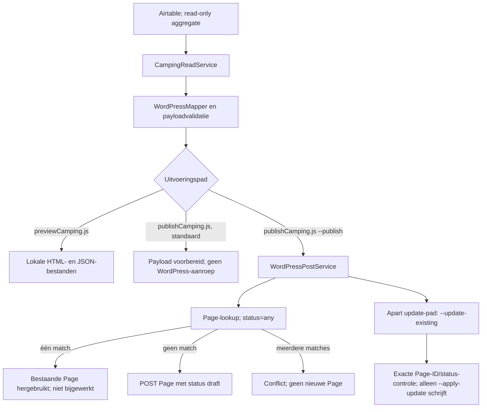

# WORDPRESS_ARCHITECTURE

| Eigenschap | Waarde |
|---|---|
| Project | RZD Builder |
| Document | WORDPRESS_ARCHITECTURE.md |
| Status | Actief |
| Rol | Gecontroleerde WordPress-concept- en Page-flow |
| Laatste wijziging | 05-11-2026 |
| Eigenaar | Pascalle Vroegop |

---

# Doel

Dit document beschrijft de gecontroleerde WordPress Page-flow vanuit **RZD Builder**. De actuele code bereidt een payload voor en ondersteunt een expliciete API-flow voor het aanmaken of hergebruiken van een Page als concept. Dit is geen bewijs van openbare publicatie.

De architectuur beschrijft uitsluitend:

- de payload- en draft-flow;
- de verantwoordelijkheden van de componenten;
- de gegevensstroom;
- de mapping tussen Builder en WordPress;
- de architectuurprincipes;
- de grenzen van mocktests, lokale controles en live-validatie.

De exacte implementatie staat in de broncode. Dit document beschrijft het waargenomen contract op hoofdlijnen en vervangt geen codecontrole.

---

# Scope

Dit document beschrijft uitsluitend de WordPress Page-payload- en conceptflow.

Het behandelt:

- de architectuur;
- de gegevensstroom;
- de verantwoordelijkheden;
- de gecontroleerde conceptpipeline;
- de veldmapping;
- de ontwerpprincipes;
- de scheiding tussen lokale preview, mocktests en live-validatie.

De lokale CampingAggregate-preview is een aparte, WordPress-vrije uitvoerroute en wordt alleen beschreven waar die de gedeelde dataflow verduidelijkt.

---

# Architectuuroverzicht

De schema-sync Builder is niet de ingang voor deze flow. Beide camping-runners halen de aggregate op via `CampingReadService`; de previewrunner schrijft alleen lokale bestanden. De WordPress-runner doet standaard geen WordPress-aanroep.



`--publish` is de expliciete API-aanroepoptie, maar de nieuwe payload heeft status `draft`; de optie zet de status niet op `publish`. Bij een bestaande match wordt de Page alleen hergebruikt, zonder status- of inhoudsupdates.

De lookup zoekt naar bestaande Pages met `status=any`, dus een reeds openbare Page wordt door hergebruik niet automatisch teruggezet naar draft. Controleer de bestaande Page-status afzonderlijk voordat deze flow wordt gebruikt.

Het afzonderlijke update-pad accepteert alleen de in de code vastgelegde Page-ID `1554`, controleert op status `draft` en vereist `--apply-update` voor de update; `--dry-run` voert geen update uit. Deze guard maakt de flow gecontroleerder, maar is geen live-validatie van de WordPress-site.

De previewroute doet geen WordPress-aanroep:

```text
previewCamping.js -> CampingReadService -> mapper/validatie -> lokale HTML + JSON
```

De WordPress-route:

```text
publishCamping.js -> CampingReadService -> WordPressMapper -> WordPressPublisher
    ├── standaard: payload voorbereiden, geen API-aanroep
    ├── --publish: lookup en eventueel Page aanmaken als draft
    └── --update-existing --dry-run|--apply-update: afzonderlijke updatecontrole
```

De runners gebruiken actuele Airtable-data via read-functies. De WordPress-API wordt alleen aangeroepen door de expliciete WordPress-modus; het previewscript schrijft uitsluitend lokaal.

De relevante implementatiebestanden zijn `scripts/previewCamping.js`, `scripts/publishCamping.js`, `services/campingReadService.js`, `services/wordpressMapper.js`, `services/wordpressPublisher.js` en `services/wordpressPostService.js`.

## Implementatie- en validatiegrens

De code scheidt aggregate-read, mapping/validatie en WordPress-API-verkeer. `CampingReadService` leest de aggregate, `WordPressMapper` maakt de Page-inhoud en `WordPressPublisher` valideert de payload. `WordPressPostService` voert de Page-lookup, aanmaak of expliciet aangevraagde update uit.

De aanwezige lokale tests bewijzen op zichzelf geen live-integratie:

- `scripts/testPublishCamping.js` vervangt de aggregate-read en WordPress-postservice door testdubbels;
- `testWordPressCampingPageReuseFlow.js` gebruikt een voorbereid payload en een gemockte `fetch`;
- `testWordPressCampingAggregateMapper.js` controleert de mapper met fixturedata.

Daarom worden implementatie, mocktest, lokale handmatige controle en live-validatie afzonderlijk gerapporteerd. De aanwezigheid van een testbestand is geen bewijs dat de test is uitgevoerd; actuele resultaten horen in `PROJECT_STATUS.md` en `CHECKPOINT.md`.

---

# RZD-presentatieprincipes

De onderstaande punten zijn normatieve presentatie-eisen, geen claim dat iedere eis al volledig in de WordPress-mapper is gerealiseerd. In de huidige mapper wordt een beoordelingsopmerking als tekst weergegeven; website- en eigen-bron worden daar niet als afzonderlijke brontypen in een eigen visueel blok verwerkt.

## RZD informeert, maar oordeelt niet

RZD geeft eerlijke, concrete en zo objectief mogelijke informatie over toegankelijkheid. RZD bepaalt niet of een locatie toegankelijk, goed, slecht, geschikt of ongeschikt is. De reiziger bepaalt zelf of de beschikbare informatie aansluit bij de eigen situatie en behoeften.

Voor iedere presentatie- en publicatielaag gelden daarom de volgende principes:

- geen groen/rood toegankelijkheidsoordeel;
- geen automatische kwalificatie "geschikt voor rolstoelgebruikers";
- geen automatische conclusie uit afzonderlijke gegevens;
- concrete feiten, maten, ondergrond, hellingen, aanwezigheid, foto's en waarnemingen zo feitelijk mogelijk presenteren;
- de herkomst van informatie zichtbaar houden wanneer die beschikbaar is;
- "Beoordeeld" beschrijft de status van het beoordelingspunt, niet zelfstandig de kwaliteit of volledigheid van de inhoud;
- een status zoals "Nog niet beoordeeld" is op zichzelf geen inhoud en wordt niet als automatisch antwoord getoond;
- informatie bij een andere status wordt herkenbaar als niet bevestigd weergegeven wanneer de mapper die inhoud presenteert;
- expliciete "Nee", `false` en "Onbekend" behouden;
- ontbrekende informatie nooit invullen met aannames;
- AI-informatie niet presenteren als RZD-eigen waarneming;
- RZD-eigen waarneming onderscheiden van informatie van de accommodatie, externe bronnen en AI;
- een eventuele No Surprises-indicatie uitsluitend informatie- en transparantiegericht houden, nooit een toegankelijkheidsoordeel of toegankelijkheidsscore.

Deze principes zijn eisen voor de lokale CampingAggregate-preview en de gewenste WordPress-presentatie. De uiteindelijke visuele presentatie in een WordPress-thema is hiermee niet gevalideerd.

---

# Accommodatiepagina

De volgende opbouw is de gewenste inhoudsstructuur voor een accommodatiepagina; de gegenereerde HTML-payload bewijst niet dat de WordPress-themaweergave visueel overeenkomstig is:

1. Bovenaan:
   - foto links;
   - accommodatie-informatie rechts.

2. Daarna:
   - korte algemene introductie;
   - daarin kunnen belangrijke praktische aandachtspunten direct duidelijk worden gemaakt.

3. Daarna:
   - compacte weergave van de 7 vaste RZD-assessmentsets:
     - Toegang & Entree
     - Parkeren
     - Verblijfsruimte
     - Sanitair
     - Slaapgedeelte
     - Balkon/Terras
     - Badkamer
   - alleen categorieën met relevante inhoud worden in de gegenereerde Page-inhoud opgenomen;
   - de mapper genereert inhoudssecties en -artikelen; een accordion of weergave waarbij één categorie geopend is, is niet door deze code bewezen.

4. Daarna:
   - Ervaringen & aandachtspunten.

5. Daarna:
   - No Surprises.

6. Daarna:
   - regionale foto;
   - afsluitend RZD-gedeelte.

7. Daarna:
   - footer.

## No Surprises

`No Surprises` is geen zelfstandig gegevensveld en krijgt geen nieuwe Airtable-kolom.

`No Surprises` is geen toegankelijkheidsoordeel, score of beoordeling van een accommodatie.

Het is een vaste RZD-boodschap/principe binnen de accommodatiepagina.

De functie is transparantie: bezoekers laten zien dat RZD concrete, feitelijke en praktische informatie geeft in plaats van marketingpraat.

De huidige mapper in `services/wordpressMapper.js` voegt deze tekst statisch toe aan de payload:

```text
NO SURPRISES

Geen marketingpraat, maar praktische informatie
```

De concrete informatie onder dit principe komt uit de bestaande RZD-informatiebronnen op de pagina. Er wordt geen aparte No-Surprises-databron gemaakt.

`Aandachtspunten`, `Opmerkingen`, `Ervaringen & aandachtspunten` en `Beoordelingen` blijven inhoudelijk afzonderlijke onderdelen.

Dit is de huidige implementatietekst, niet een bevestiging dat de redactionele keuze definitief is. De definitieve No Surprises-tekst kan nog openstaan.

De payload is bedoeld voor WordPress `Pages`. De standaardrunner verstuurt geen Page; de expliciete API-flow maakt een nieuwe Page met status `draft` of hergebruikt een bestaande Page zonder die bij te werken. Openbare publicatie wordt door deze flow niet aangevraagd.

`Posts` zijn bedoeld voor nieuws/artikelen.

De gewenste accommodatiepagina-layout is richtinggevend voor toekomstige implementatie, maar de actuele WordPress-themaweergave is niet met een live Page of browsercontrole bewezen.

Het ontwerp mag niet door technische implementatiedetails worden veranderd.
```
